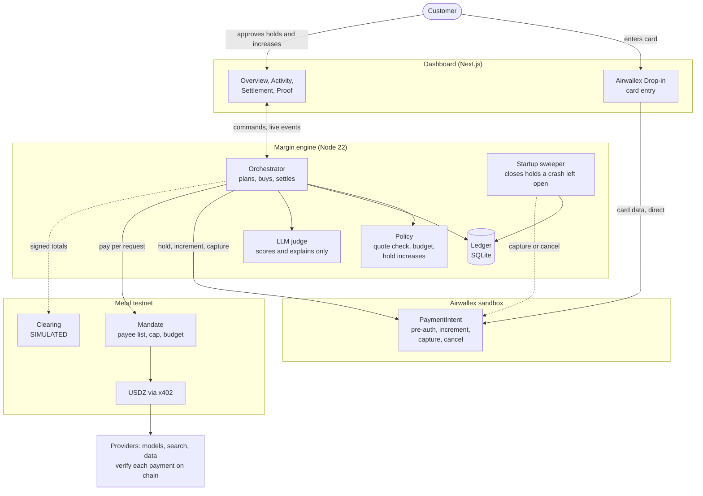
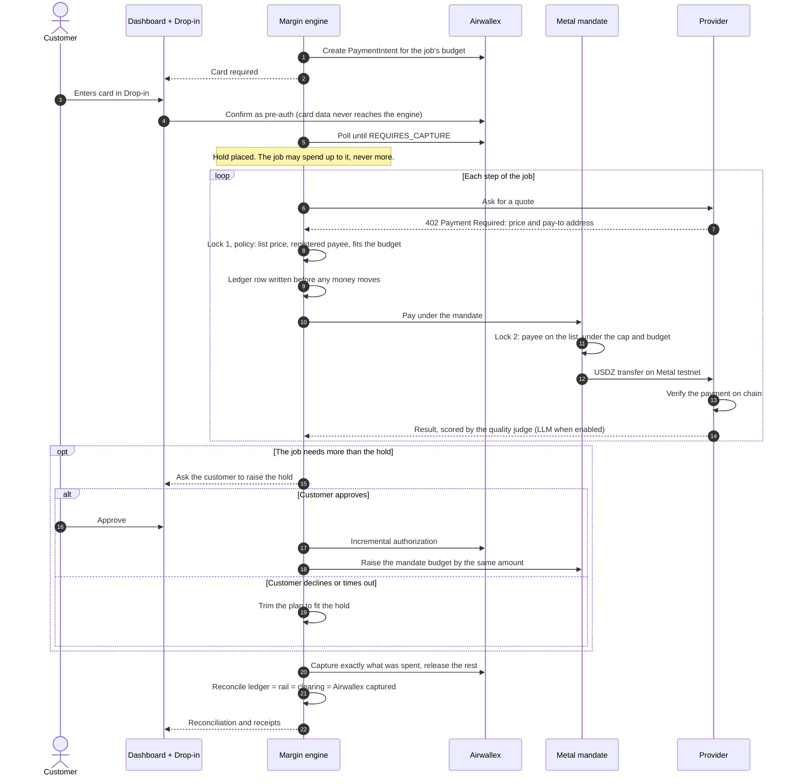

# Margin

Margin is an inference sourcing agent. It runs AI research jobs and buys every paid step (model calls, web search, data lookups) from whichever provider best fits what's left of that job's budget.

- **Customer approval.** Each customer approves a spending cap up front as an Airwallex card pre-authorization.
- **Payments.** Margin pays providers per request in USDZ on Metal, and adapts when prices or latency change.
- **Settlement.** It captures only what the job actually spent and releases the rest.

**It never charges a customer past their hold without asking, and it never pays a provider more than its published price.**

Airwallex Agentic Banking Hackathon, Starter Kit 12 ("Inference Sourcing Agent").

## For judges

**What's live.** Card holds run in the Airwallex sandbox, with the card entered in Airwallex Drop-in. Provider payments are x402 on Metal testnet, through a Metal mandate. All of these ran together in one dashboard run that reconciled to the cent: $1.47 matched across the ledger, the chain and Airwallex, with 0 violations. [Read the run](docs/live-runs/2026-11-09-dashboard-all-live-run.md); every transaction is linked.

**What's simulated, and labelled so on screen.** Metal clearing: Margin runs it through an emulator that follows Metal's clearing rules. Metal's live testnet clearing (the `bajillion` x402 scheme) is available, and wiring it into Margin is the next step. Without keys, every other rail falls back to a simulation with the same rules.

**Quickest look, no keys needed (about 3 minutes, plus a 1-minute install):**

```bash
npm install
npm run check     # typecheck, 158 unit tests, 10,000-run simulation, sabotage proof
npm run demo      # scripted 3-customer scenario in the terminal, with narration and reconciliation
```

**What to look for in a run:**

| Moment | What it shows |
|---|---|
| A customer approves a card hold in Drop-in | The spending cap is a real Airwallex pre-authorization; card data never touches our server |
| The agent picks the cheapest provider that fits the job's budget | Sourcing; the dashboard feed gives the policy reason for each choice |
| A rogue provider asks for 3× its list price | Our quote check refuses it before anything is paid |
| Our check is switched off, and the rogue asks to be paid at an unregistered address | The Metal mandate refuses it on its own, and the refusal is recorded on chain |
| A job runs over, and the customer is asked to raise the hold | B approves (a live Airwallex incremental authorization); C declines and the plan degrades instead |
| The run ends | Each hold is captured for exactly what was spent and the rest released. The reconciliation table checks the ledger against the chain and Airwallex |

**Evidence from live runs:** [docs/live-runs/](docs/live-runs/). Full state, with what is and isn't done: [docs/STATUS.md](docs/STATUS.md).

## Run the dashboard

Two processes, both production builds:

```bash
npm run dashboard:install && npm run dashboard:build   # once
npm run engine:offline                                  # terminal 1: engine on :4100, every rail simulated
npm run dashboard                                       # terminal 2: open http://localhost:3000
```

Press **Run scripted demo**, then approve B's hold increase and decline C's; that hits every beat.

Swap `engine:offline` for a live engine (keys in `.env`, see [.env.example](.env.example)):

| Command | Live rails | Needs |
|---|---|---|
| `npm run engine:live-full` | Airwallex holds + Metal payments through a mandate | `AIRWALLEX_CLIENT_ID`, `AIRWALLEX_API_KEY`, `METAL_RPC_URL`, `METAL_OWNER_ACCOUNT`, `METAL_OWNER_KEY_FILE` |
| `npm run engine:live-cards` | Airwallex holds | the two Airwallex keys |
| `npm run engine:live-mandate` | Metal payments through a mandate | the Metal owner variables |
| `npm run engine:live` | Metal x402 from the agent wallet | `METAL_PRIVATE_KEY`, `METAL_RPC_URL` |

**Live cards:** a Drop-in form opens for each customer. Use Airwallex's sandbox test card `4035 5010 0000 0008`, any future expiry and any CVC. Every receipt links its transaction on the testnet explorer and its Airwallex PaymentIntent. A scripted run spends about 1.5 testnet USDZ. Metal needs the system clock in sync.

The **Disable our quote check (mandate test)** button turns our check off for one attempt, so you can watch the mandate refuse the rogue on its own.

`npm run engine` uses the LLM key in `.env` (Gemini or Claude) for the quality judge, the feed lines and the report text. Add `--no-llm`, or use the commands above, to leave it off.

### Scripts against the live rails

```bash
npm run live:x402        # one job, real x402 payments, every tx re-read from chain (at most 0.25 USDZ)
npm run live:mandate     # Metal mandate lifecycle: bind, pay, refusals recorded on chain, raise, revoke
npm run test:live        # adapter contract tests against the real Metal gateway (~0.03 USDZ)
```

Node ≥ 22.13.

## Architecture

### The system



Card data goes from Drop-in straight to Airwallex; the engine only ever sees the PaymentIntent. The LLM never moves money: every payment decision is made by the policy module, and every payment passes two locks, our quote check and then the Metal mandate.

### One job, end to end



If the engine crashes mid-job, the hold stays open at Airwallex. On the next start, the sweeper reads that run's ledger and captures what was spent or cancels the hold.

### Where it lives

| Part | Code |
|---|---|
| Orchestrator: plans each job, buys steps, asks for increases, settles | [src/engine/](src/engine/) |
| Policy: quote check, budget, hold-increase planning, as pure functions | [src/policy/](src/policy/) |
| Ledger: idempotent payments and holds in SQLite; startup sweeper | [src/ledger/](src/ledger/) |
| Airwallex holds, Drop-in wait, Metal x402 payments, mandates | [src/payments/](src/payments/) |
| Providers: x402 servers that verify each payment on chain | [src/providers/](src/providers/) |
| Clearing emulator (signed running totals, finality) | [src/clearing/](src/clearing/) |
| LLM judge, feed narration, report text | [src/agent/](src/agent/) |
| Engine server and crash recovery | [src/server/](src/server/) |
| Dashboard | [apps/dashboard/](apps/dashboard/) |
| 10,000-run simulation and sabotage proof | [src/sim/](src/sim/) |

## LIVE vs SIMULATED

| Component | Live | Offline / without keys |
|---|---|---|
| Airwallex card holds | **LIVE, sandbox.** Card entered in Drop-in; increment, capture and cancel are real; reconciliation reads each intent back | `MockAirwallex`, same rules |
| Metal x402 payments | **LIVE, testnet.** Providers verify each payment on chain before delivering | `MockMetal` |
| Metal mandates | **LIVE, testnet.** Refusals recorded on chain | Simulated mandate, same checks |
| Metal clearing | SIMULATED in every mode: Margin uses its emulator; Metal's live testnet clearing isn't wired in yet | `ClearingEmulator` |
| LLM (judge, feed, report) | Gemini (`gemini-3.5-flash-lite`) or Claude | Template text |

The dashboard shows MODE and a LIVE or SIM badge on every rail, column and receipt.

## Guardrails, in code

| Rule | Where |
|---|---|
| Capture ≤ hold, exactly what was spent, floored to the cent; zero spend cancels | [orchestrator.ts `settleHold`](src/engine/orchestrator.ts) |
| Raise the hold before spending past it | [policy.ts `planHoldIncrease`](src/policy/policy.ts), [orchestrator.ts `askForMore`](src/engine/orchestrator.ts) |
| Nothing paid twice: ledger row before money moves, one key per purchase; on chain the ERC-3009 nonce comes from that key; Airwallex calls use deterministic `request_id`s | [ledger.ts `beginPayment`](src/ledger/ledger.ts), [metal.ts `nonceFor`](src/payments/metal.ts), [airwallex.ts](src/payments/airwallex.ts) |
| Providers deliver only after reading the payment on chain | [verify.ts `ChainPaymentVerifier`](src/providers/verify.ts) |
| Never pay above list price or to an unregistered address, checked twice | [policy.ts `verifyQuote`](src/policy/policy.ts), then the Metal mandate ([mandate-manager.ts](src/payments/mandate-manager.ts)) |
| The LLM never moves money | [ports.ts `QualityJudge`](src/engine/ports.ts) |
| Capture only after clearing is final | [orchestrator.ts `finalizeClearing`](src/engine/orchestrator.ts) |
| Every hold ends captured or cancelled, even after a crash: the startup sweeper settles holds a crashed run left open | [sweeper.ts](src/ledger/sweeper.ts), [recover.ts](src/server/recover.ts) |
| Card data never touches our server | [CardModal.tsx](apps/dashboard/components/CardModal.tsx) (Airwallex Drop-in), [airwallex-browser.ts](src/payments/airwallex-browser.ts) |

## Proof

`npm run sim` runs 10,000 seeded random scenarios: overruns, slowdowns, rogue providers, dropped acknowledgements, issuer declines, and customer declines and timeouts. It checks 12 families of invariants, including 5 for the simulated clearing layer:

> 10,000 simulated runs · 0 overcharges · 0 double payments · 0 orphaned holds · 0 rogue overpayments

`npm run sim:sabotage` runs the same checks against 5 deliberately broken engines and shows each one is caught. The breakages are a skipped quote check, a fresh key on retry, an ignored hold, a full-hold capture, and a capture before clearing is final.

## Team

Rahul Pal (payments and backend) and Kavisha Sharma (agent and product).
