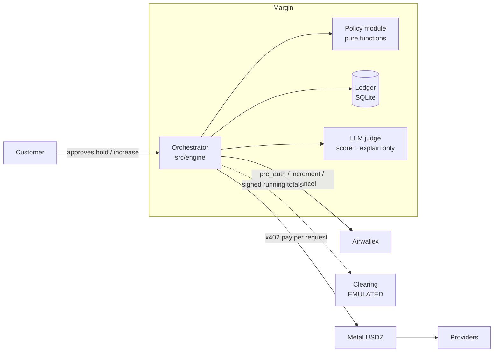

# Margin

Margin is an inference sourcing agent. It runs AI research jobs and buys every paid step (model calls, web search, data lookups) from whichever provider best fits what is left of that job's budget. Each customer approves a spending cap up front as an Airwallex card pre-authorization. Margin pays providers per request in USDZ on Metal, adapts when prices or latency change, and captures only what the job actually spent. **It never charges a customer past their hold without asking, and it never pays a provider more than its published price.**

Airwallex Agentic Banking Hackathon, Starter Kit 12 ("Inference Sourcing Agent").

> **Status:** every payment rail runs in mock mode today, labelled SIMULATED. Only the LLM (Gemini or Claude) can be LIVE. See [docs/STATUS.md](docs/STATUS.md).

## Run it (no keys needed)

```bash
npm install
npm run demo      # scripted 3-job scenario with narration and reconciliation
npm run check     # typecheck + unit tests + 10,000-run sim + sabotage proof
```

### Dashboard

Two processes, both production builds (never a dev server in a recording):

```bash
npm run dashboard:install && npm run dashboard:build   # once
npm run engine:offline                                  # terminal 1: engine on :4100 (npm run engine uses the LLM key in .env)
npm run dashboard                                       # terminal 2: open http://localhost:3000
```

Press **Run scripted demo** and answer the hold-increase prompts (approve B, decline C hits every demo beat).

Node ≥ 22.13. Live mode needs the variables in [.env.example](.env.example).

## Architecture



## LIVE vs SIMULATED

| Component | Today | Target |
|---|---|---|
| Airwallex holds | mock | sandbox (LIVE) |
| Metal x402 payments | mock | testnet (LIVE) |
| Metal mandates | — | testnet (LIVE) |
| Metal clearing | **SIMULATED** | stays SIMULATED until Metal opens testnet clearing |

## Guardrails, in code

| Rule | Where |
|---|---|
| Capture ≤ hold, exactly what was spent, floored to the cent; zero spend cancels | [orchestrator.ts `settleHold`](src/engine/orchestrator.ts) |
| Raise the hold before spending past it | [policy.ts `planHoldIncrease`](src/policy/policy.ts), [orchestrator.ts `askForMore`](src/engine/orchestrator.ts) |
| Nothing paid twice: ledger row before money moves, one key per purchase | [ledger.ts `beginPayment`](src/ledger/ledger.ts), [sqlite.ts](src/ledger/sqlite.ts) |
| Never pay above list price or to an unregistered address | [policy.ts `verifyQuote`](src/policy/policy.ts), [catalog.ts](src/policy/catalog.ts) |
| The LLM never moves money | [ports.ts `QualityJudge`](src/engine/ports.ts) |
| Capture only after clearing is final | [orchestrator.ts `finalizeClearing`](src/engine/orchestrator.ts) |

## Proof

`npm run sim` runs 10,000 seeded random scenarios (overruns, slowdowns, rogue providers, dropped acknowledgements, issuer declines, customer declines and timeouts) and checks 12 invariant families, including 5 for the simulated clearing layer:

> 10,000 simulated runs · 0 overcharges · 0 double payments · 0 orphaned holds · 0 rogue overpayments

`npm run sim:sabotage` runs the same checks against 5 deliberately broken engines (skipped quote check, fresh key on retry, ignored hold, full-hold capture, capture before clearing finality) and shows each one is caught.
