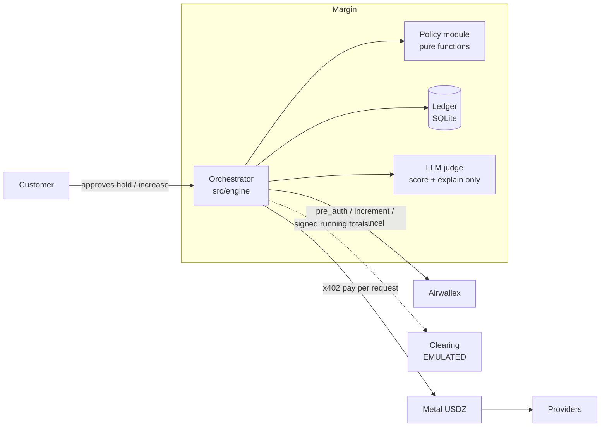

# Margin

Margin is an inference sourcing agent. It runs AI research jobs and buys every paid step (model calls, web search, data lookups) from whichever provider best fits what is left of that job's budget. Each customer approves a spending cap up front as an Airwallex card pre-authorization. Margin pays providers per request in USDZ on Metal, adapts when prices or latency change, and captures only what the job actually spent. **It never charges a customer past their hold without asking, and it never pays a provider more than its published price.**

Airwallex Agentic Banking Hackathon, Starter Kit 12 ("Inference Sourcing Agent").

> **Status:** provider payments are **LIVE on Metal testnet** (x402 via Metal's facilitator, verified on chain by the providers; `npm run live:x402`). Card holds and clearing are SIMULATED, and the demo and dashboard run fully mocked. See [docs/STATUS.md](docs/STATUS.md).

## Run it (no keys needed)

```bash
npm install
npm run demo      # scripted 3-job scenario with narration and reconciliation
npm run check     # typecheck + unit tests + 10,000-run sim + sabotage proof
```

### Dashboard

Two processes, both production builds (never a dev server in a recording):

```bash
npm run dashboard:install && npm run dashboard:build   # once
npm run engine:offline                                  # terminal 1: engine on :4100 (npm run engine uses the LLM key in .env)
npm run dashboard                                       # terminal 2: open http://localhost:3000
```

Press **Run scripted demo** and answer the hold-increase prompts (approve B, decline C hits every demo beat).

**With real Metal testnet payments:** run `npm run engine:live` instead of `engine:offline`. The header shows MODE: MIXED, the Metal rail LIVE, and every receipt links its transaction on the testnet explorer. A scripted run spends about 1.4 testnet USDZ. It needs `METAL_PRIVATE_KEY`, `METAL_RPC_URL` and a synced clock; add the LLM with `npm run engine -- --live-metal`.

**Two locks on every payment.** Our policy check (`verifyQuote`), then a Metal mandate the payment goes through: payee allowlist, per-payment cap, budget. Offline the mandate is SIMULATED. `npm run engine:live-mandate` uses a real one on the owner's MetalAccount (needs `METAL_OWNER_ACCOUNT` and `METAL_OWNER_KEY_FILE`). The **Disable our quote check (mandate test)** button turns our check off for one attempt, so you can watch the mandate refuse the rogue on its own.

In Claude Code, `.claude/launch.json` defines `engine` (offline), `engine-live` and `dashboard` for the in-app browser preview when the session is opened in this folder.

### Live on Metal testnet

Needs `METAL_PRIVATE_KEY` (funded with testnet USDZ) and `METAL_RPC_URL` in `.env`, and a synced system clock:

```bash
npm run live:x402     # one job, real x402 payments, every tx re-read from chain; spends at most 0.25 USDZ
npm run test:live     # adapter contract tests against the real gateway (~0.03 USDZ)
npm run live:mandate  # Metal mandate lifecycle on chain: bind, pay, refusals recorded on chain, raise, revoke
```

Node ≥ 22.13. Live mode needs the variables in [.env.example](.env.example).

## Architecture



## LIVE vs SIMULATED

| Component | Today | Target |
|---|---|---|
| Airwallex holds | mock (sandbox blocked: Payments not available in the team's region) | sandbox (LIVE) |
| Metal x402 payments | **LIVE on testnet** in `npm run live:x402`; mock in demo and dashboard | testnet (LIVE) everywhere |
| Metal mandates | **LIVE on testnet** via `engine:live-mandate` and `live:mandate` (refusals recorded on chain); SIMULATED offline | testnet (LIVE) |
| Metal clearing | **SIMULATED** | stays SIMULATED until Metal opens testnet clearing |

## Guardrails, in code

| Rule | Where |
|---|---|
| Capture ≤ hold, exactly what was spent, floored to the cent; zero spend cancels | [orchestrator.ts `settleHold`](src/engine/orchestrator.ts) |
| Raise the hold before spending past it | [policy.ts `planHoldIncrease`](src/policy/policy.ts), [orchestrator.ts `askForMore`](src/engine/orchestrator.ts) |
| Nothing paid twice: ledger row before money moves, one key per purchase; on chain the ERC-3009 nonce is derived from that key | [ledger.ts `beginPayment`](src/ledger/ledger.ts), [sqlite.ts](src/ledger/sqlite.ts), [metal.ts `nonceFor`](src/payments/metal.ts) |
| Providers deliver only after reading the payment on chain | [verify.ts `ChainPaymentVerifier`](src/providers/verify.ts) |
| Never pay above list price or to an unregistered address | [policy.ts `verifyQuote`](src/policy/policy.ts), [catalog.ts](src/policy/catalog.ts) |
| The LLM never moves money | [ports.ts `QualityJudge`](src/engine/ports.ts) |
| Capture only after clearing is final | [orchestrator.ts `finalizeClearing`](src/engine/orchestrator.ts) |

## Proof

`npm run sim` runs 10,000 seeded random scenarios (overruns, slowdowns, rogue providers, dropped acknowledgements, issuer declines, customer declines and timeouts) and checks 12 invariant families, including 5 for the simulated clearing layer:

> 10,000 simulated runs · 0 overcharges · 0 double payments · 0 orphaned holds · 0 rogue overpayments

`npm run sim:sabotage` runs the same checks against 5 deliberately broken engines (skipped quote check, fresh key on retry, ignored hold, full-hold capture, capture before clearing finality) and shows each one is caught.
