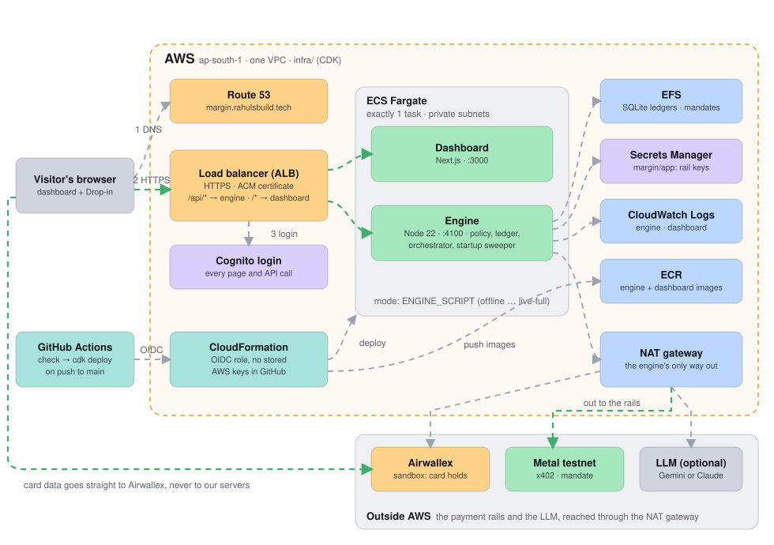

# Deploying Margin to AWS

One ECS Fargate task (engine + dashboard) behind an HTTPS Application Load Balancer with a Cognito login.
Everything is defined in AWS CDK under [`infra/`](../infra).

```
Route 53 ─► ALB :443  (ACM cert · Cognito login · idle timeout 300 s for SSE)
              ├─ /api/*  ─► engine    :4100   (Dockerfile.engine)
              └─ /*      ─► dashboard :3000   (apps/dashboard/Dockerfile)
ECS Fargate service, exactly 1 task, private subnets
EFS at /app/data        SQLite run ledgers + Metal mandate credentials
Secrets Manager         margin/app: one JSON object of engine env vars
CloudWatch Logs         engine/* and dashboard/* streams
```



**This repo's deployment:**
- **Site:** https://margin.rahulsbuild.tech, in `ap-south-1`.
- **Config:** the domain and hosted zone are set in [`infra/cdk.json`](../infra/cdk.json).
- **Logins:** created by hand in the Cognito user pool. They're never written in this repo.

**Why exactly one task.** The engine keeps its single `DemoSession` in memory, streams it over SSE, and is the
only writer of the SQLite ledgers. The service never scales out, and deployments stop the old task before the
new one starts (`minHealthyPercent: 0`, `maxHealthyPercent: 100`), so expect ~1–2 minutes of downtime per deploy.

## What you need

- An AWS account and a **Route 53 hosted zone** for a domain you own (e.g. `example.com`). You'll deploy to a
  subdomain such as `margin.example.com`.
- Locally, once: Node 22 and the [AWS CLI](https://aws.amazon.com/cli/) signed in to the account (`aws configure sso` or
  `aws configure`). Docker is **not** needed locally if you deploy through GitHub Actions.

## 1. Bootstrap CDK and create the CI role (once, from your laptop)

```bash
cd infra
npm ci
npx cdk bootstrap aws://<ACCOUNT_ID>/<REGION>
npm run deploy:ci
```

`MarginCi` creates GitHub's OIDC provider and a role `margin-github-deploy` that only the `main` branch of
`rahulcse129/AgentXPayU` can assume. If your account already has a GitHub OIDC provider, pass its ARN:
`npx cdk deploy MarginCi -c githubOidcProviderArn=arn:aws:iam::<ACCOUNT_ID>:oidc-provider/token.actions.githubusercontent.com`.

Note the `DeployRoleArn` output.

## 2. Configure the GitHub repo

Settings → Secrets and variables → Actions → **Variables**:

| Variable | Example | |
|---|---|---|
| `AWS_DEPLOY_ROLE_ARN` | `arn:aws:iam::…:role/margin-github-deploy` | from step 1 |
| `AWS_REGION` | `ap-south-1` | the region you bootstrapped |
| `MARGIN_DOMAIN` | `margin.example.com` | optional: overrides `domainName` in `infra/cdk.json` |
| `MARGIN_ZONE_ID` | `Z0123456789ABC` | optional: overrides `hostedZoneId` (Route 53 → Hosted zones) |
| `MARGIN_ZONE_NAME` | `example.com` | optional: overrides `hostedZoneName` |
| `MARGIN_ENGINE_SCRIPT` | `engine:offline` | optional; see "Engine modes" |
| `MARGIN_ALLOWED_CIDRS` | `203.0.113.4/32` | optional; restricts the ALB to these IPs |

No AWS keys go into GitHub.

## 3. Deploy

Push to `main` (or run the **Deploy to AWS** workflow by hand). The workflow runs `npm run check` and then
`cdk deploy MarginApp`, which builds both images, pushes them to ECR and updates the stack. The first deploy
takes ~15 minutes (VPC, NAT, certificate validation).

Deploying from your laptop instead needs Docker running:

```bash
cd infra
npx cdk deploy MarginApp -c domainName=margin.example.com -c hostedZoneId=Z0123456789ABC -c hostedZoneName=example.com
```

## 4. After the first deploy

1. **Create users.** Cognito console → the user pool in the `UserPoolId` output → Users → Create user. Self sign-up
   is off; only users you create can open the dashboard or call the API.
2. **Fill in secrets** (only needed for live modes or the LLM). The easy way is
   `node deploy/push-secrets.mjs` (a dry run that prints key names only), then the same command with `--apply`.
   It copies the engine keys from your `.env`, including the owner key file's contents. By hand, go to
   Secrets Manager → `margin/app` → Retrieve secret value → Edit → Plaintext, and save a JSON object of the
   same variables as `.env.example`:

   ```json
   {
     "GEMINI_API_KEY": "…",
     "AIRWALLEX_CLIENT_ID": "…",
     "AIRWALLEX_API_KEY": "…",
     "AIRWALLEX_BASE_URL": "https://api.sandbox.airwallex.com",
     "METAL_RPC_URL": "…",
     "METAL_PRIVATE_KEY": "…",
     "METAL_OWNER_ACCOUNT": "…",
     "METAL_OWNER_KEY": "<the full contents of the metal-agent owner key file>"
   }
   ```

   `METAL_OWNER_KEY` is the *contents* of the key file; [`deploy/entrypoint.mjs`](../deploy/entrypoint.mjs) writes it to
   a `0600` file in the container and sets `METAL_OWNER_KEY_FILE`. CDK created the secret as `{}` and never overwrites it.
3. **Restart the task** so it reads the new secret: ECS → cluster → service → Update → Force new deployment.
4. **Airwallex Drop-in** (live cards only): if your Airwallex sandbox restricts allowed origins/domains, add
   `https://margin.example.com`.

## Engine modes

`MARGIN_ENGINE_SCRIPT` (or `-c engineScript=…`) picks the npm script the engine runs:

| Script | Rails | Needs in `margin/app` |
|---|---|---|
| `engine:offline` (default) | everything simulated, LLM off; costs nothing per run | nothing |
| `engine` | simulated rails, LLM on | `GEMINI_API_KEY` or `LLM_API_KEY` |
| `engine:live` | live Metal x402 | `METAL_RPC_URL`, `METAL_PRIVATE_KEY` |
| `engine:live-cards` | live Airwallex holds | Airwallex keys |
| `engine:live-mandate` | live Metal mandate | `METAL_RPC_URL`, `METAL_OWNER_ACCOUNT`, `METAL_OWNER_KEY` |
| `engine:live-full` | live Airwallex + live mandate | all of the above |

Each live scripted run spends about 1.4 testnet USDZ. Anyone who can sign in can start runs, so create users accordingly.

## Operating it

- **Logs:** CloudWatch → the `LogGroup` output. The engine's `[sweeper]` lines on start say whether any live hold
  was left open by a crash (`NEEDS ATTENTION`).
- **Shell into the task:** `aws ecs execute-command --cluster <ClusterName> --task <task-id> --container engine --interactive --command sh`
  (needs the Session Manager plugin).
- **Data:** the EFS file system and the Cognito user pool are kept (`RETAIN`) even if you delete the stack, so live
  ledgers are never lost by accident. Delete them by hand if you really mean to.
- **SQLite on EFS:** the ledgers use WAL mode. This is safe here because only one task, on one host, ever opens them.
  Don't raise the task count.
- **Domain change:** the dashboard is built with `NEXT_PUBLIC_ENGINE_URL=same-origin` and calls `/api` on
  whatever host serves it, so changing the domain needs no dashboard rebuild.
- **No domain?** Leave the three domain variables unset and set a GitHub **secret** `MARGIN_BASIC_AUTH`
  (`user:password`). The stack then serves the app at a free `https://dxxxx.cloudfront.net` URL behind a
  browser password prompt, with the ALB accepting only CloudFront traffic carrying a secret header.

## Files

| File | What it is |
|---|---|
| [`Dockerfile.engine`](../Dockerfile.engine) | Engine image (Node 22, runs TypeScript with tsx) |
| [`apps/dashboard/Dockerfile`](../apps/dashboard/Dockerfile) | Dashboard image (Next.js production build) |
| [`deploy/entrypoint.mjs`](../deploy/entrypoint.mjs) | Expands the secret JSON, writes the owner key file, starts the chosen engine script |
| [`infra/lib/margin-stack.ts`](../infra/lib/margin-stack.ts) | The app stack |
| [`infra/lib/ci-stack.ts`](../infra/lib/ci-stack.ts) | GitHub OIDC deploy role |
| [`.github/workflows/deploy.yml`](../.github/workflows/deploy.yml) | Check, then `cdk deploy` on push to `main` |
